

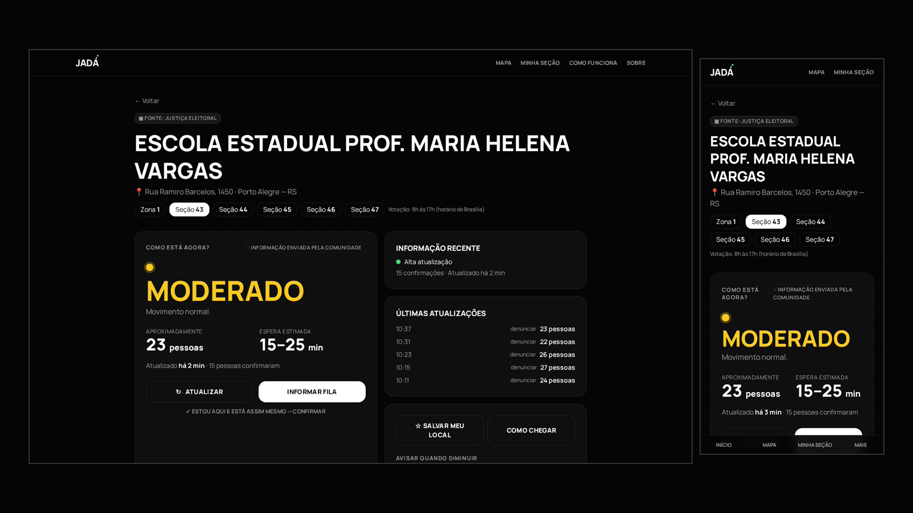

# JADÁ — Já Dá Pra Ir?

**Saiba quando ir.** Veja como está a fila no seu local de votação, em tempo real, com informações enviadas pela própria comunidade.

[Ver o vídeo](media/demo.mp4) · [Capturas de tela](#-capturas-de-tela) · [Como contribuir](CONTRIBUTING.md) · [Roadmap](ROADMAP.md) · [Abrir uma issue](../../issues/new/choose)

> [!NOTE]
> Este é o repositório **vitrine** do JADÁ: apresentação, imagens, vídeo, roadmap e espaço aberto para feedback.
> O código-fonte do aplicativo é **privado** e não está neste repositório. Veja em [Como contribuir](#-como-contribuir) como participar, inclusive como pedir acesso para colaborar com código.

---

## 💡 O problema

No dia da eleição, milhões de pessoas saem de casa sem saber se vão encontrar o local de votação vazio ou uma fila de uma hora. Quem pode escolher o horário (idosos, pais com crianças pequenas, quem trabalha no dia) não tem nenhuma informação para decidir **quando** ir.

## ✅ A solução

O **JADÁ** junta duas fontes, sempre separadas visualmente:

| | Fonte | O que mostra |
|---|---|---|
| ▣ **Dados oficiais** | Justiça Eleitoral (dados abertos do TSE) | Local de votação, endereço, município, zona e seções |
| ○ **Dados da comunidade** | Pessoas que estão no local | Tamanho aproximado da fila, tempo de espera e confirmações |

Quem está na fila informa em poucos toques quantas pessoas tem na frente. O app calcula uma estimativa robusta para cada seção e mostra no mapa e na página do local se **já dá pra ir**.

O JADÁ **não é um produto político**: não mostra candidatos, partidos, pesquisas nem intenção de voto, e não pede nenhum dado sobre o voto. Não representa a Justiça Eleitoral.

## 🎬 Demonstração

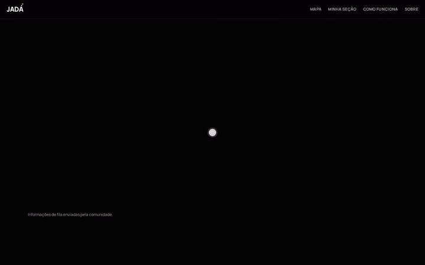

Versão em vídeo (MP4, ~1 min): <a href="media/demo.mp4"><b>media/demo.mp4</b></a>

> As imagens e o vídeo usam **dados fictícios de demonstração** (locais, endereços e relatos inventados) para mostrar todos os estados da interface. A versão real usa a base oficial do TSE.

## ✨ Funcionalidades

- **Busca do local de votação** por cidade, bairro, zona, seção ou nome da escola, no Brasil inteiro, sem acento e sem cadastro.
- **Status da fila por seção**: Tranquilo, Moderado, Movimento alto, Muito movimento ou **Relatos divergentes**, com pessoas aproximadas, espera estimada e há quanto tempo foi atualizado.
- **Informar fila** em 3 passos ("Você está neste local?" → quantas pessoas na sua frente → há quanto tempo espera).
- **Confirmar** um relato ("estou aqui e está assim mesmo") e **denunciar** relatos falsos.
- **Estimativa robusta**: mediana ponderada pelo tempo (relatos recentes valem mais), descarte de valores fora da curva, detecção de relatos que não concordam entre si e limite por relato igual ao número de eleitores da seção.
- **Proteção contra abuso**: um relato por aparelho por seção a cada 10 minutos (o novo substitui o anterior), limites de requisição, uma confirmação por aparelho e relato oculto após 3 denúncias.
- **Mapa do Brasil** com níveis de zoom: no país, os locais mais relevantes de cada estado; no estado, os principais locais; no município, todos. Filtro por nível de movimento, zoom e arraste.
- **Minha seção**: salve seu local e sua seção no aparelho (sem conta) e veja o status direto. Ele aparece sempre destacado no mapa.
- **Histórico do dia** por hora, para entender os horários de pico.
- **Funciona no celular** (layout mobile com navegação inferior) e tem um modo de demonstração quando o servidor está fora do ar.

## 📸 Capturas de tela

### Desktop

| Início | Busca |
|---|---|
| 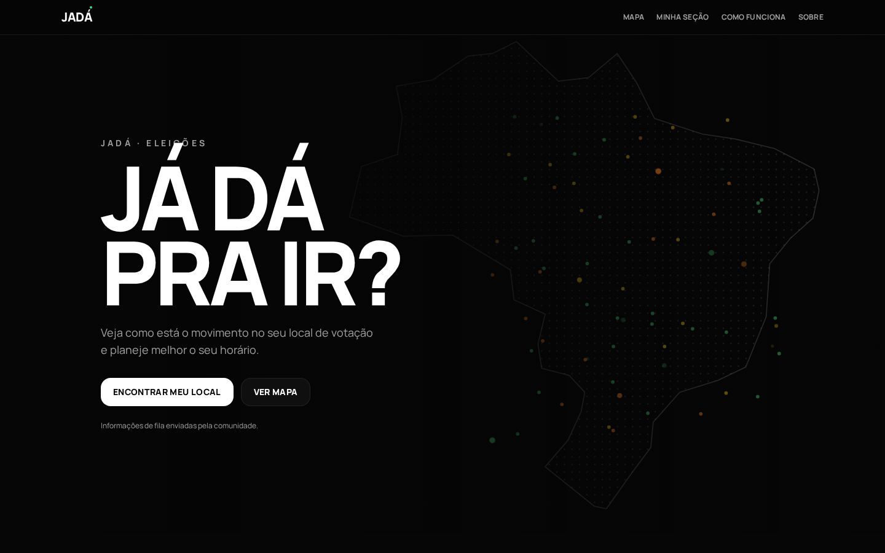 | 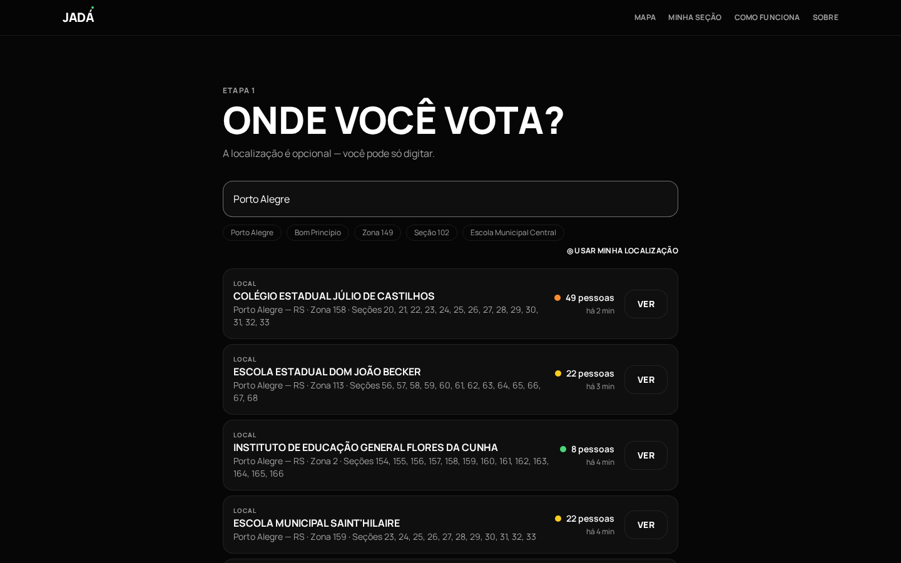 |
| **Página do local: Moderado** | **Informar fila** |
|  | 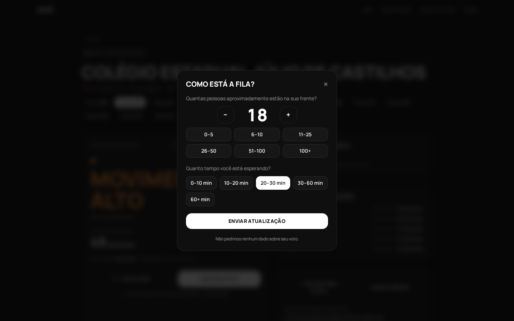 |
| **Muito movimento** | **Relatos divergentes** |
| 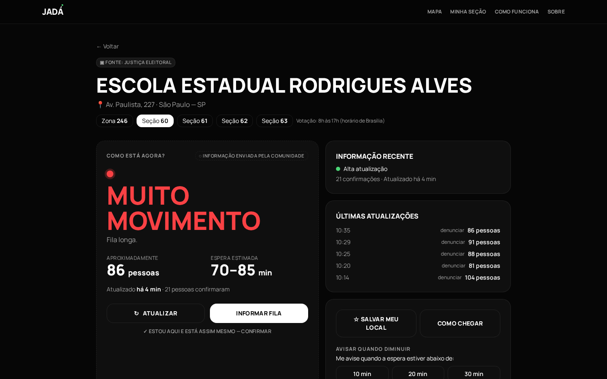 | 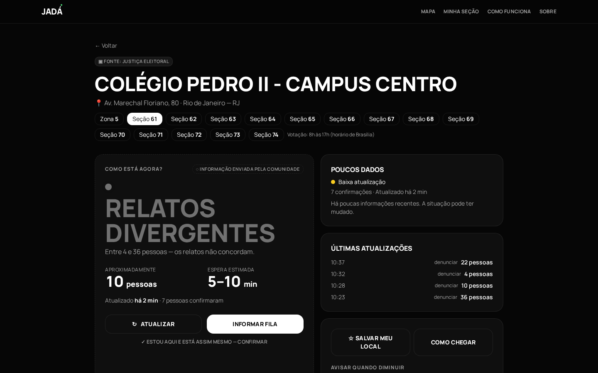 |
| **Mapa: Brasil** | **Mapa: estado (RS)** |
| 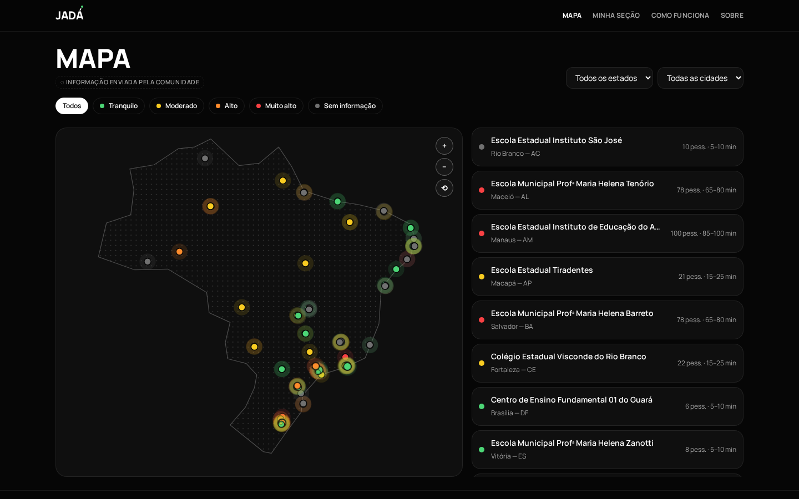 | 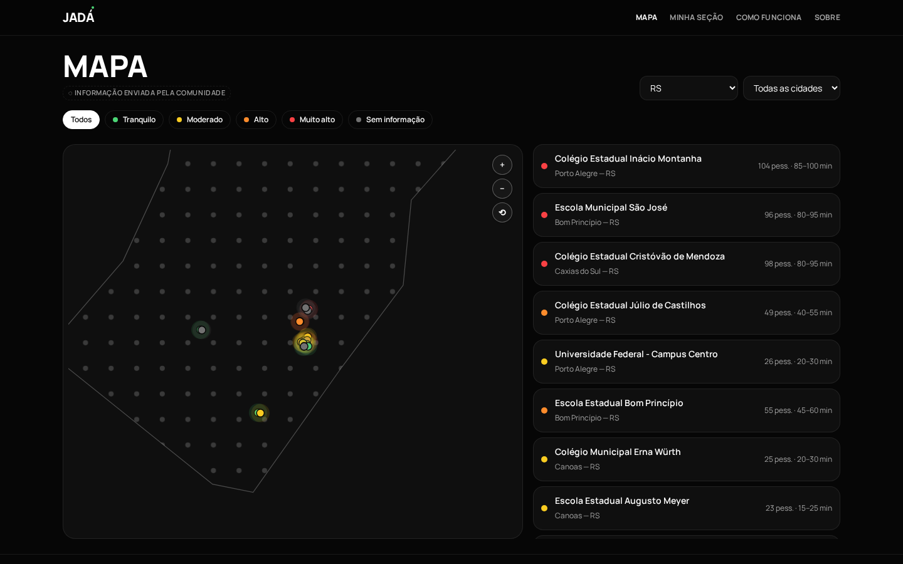 |
| **Minha seção** | **Como funciona** |
|  |  |

Página do local completa (com o histórico do dia)

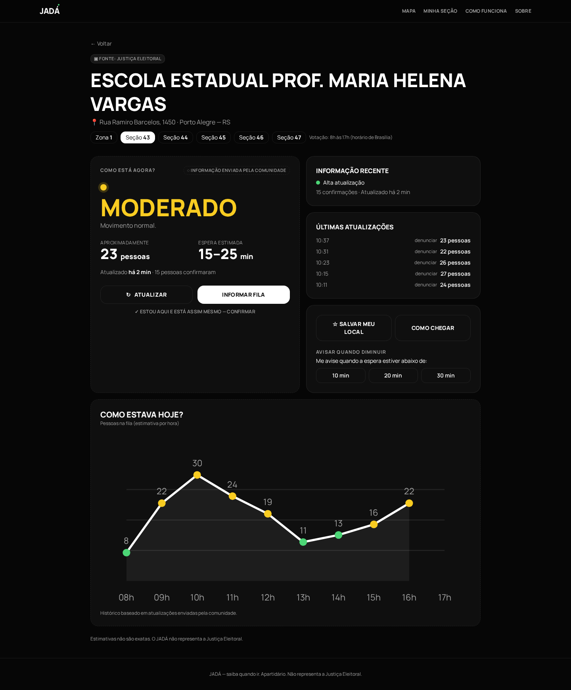

### Celular

| Início | Busca | Local | Informar fila | Minha seção |
|---|---|---|---|---|
|  | 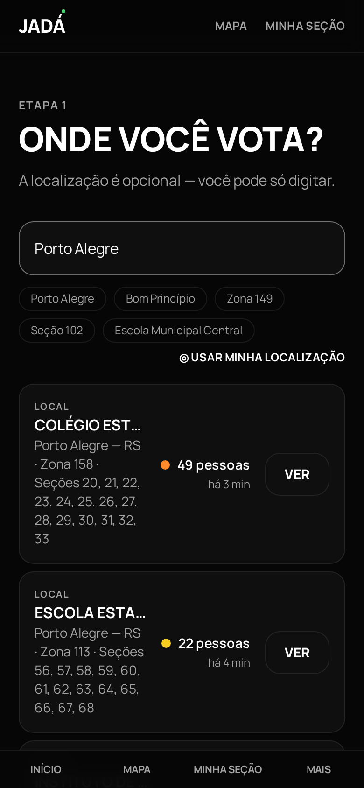 | 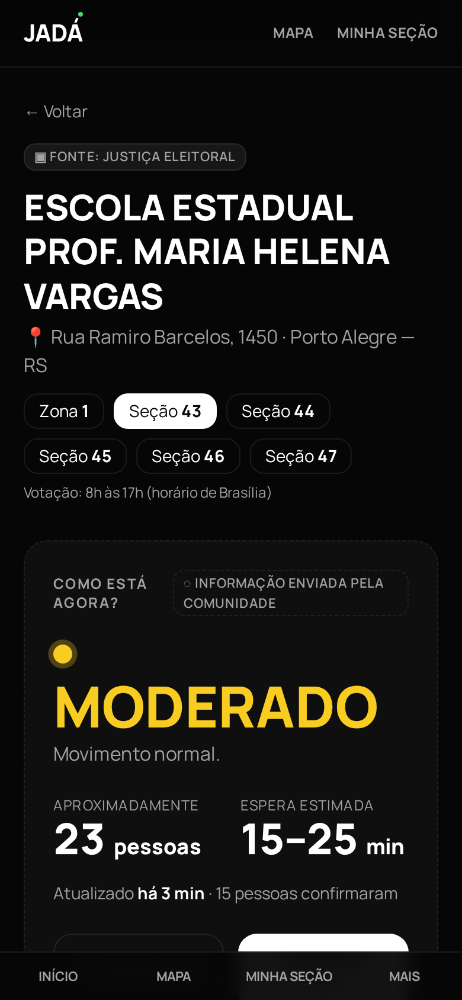 | 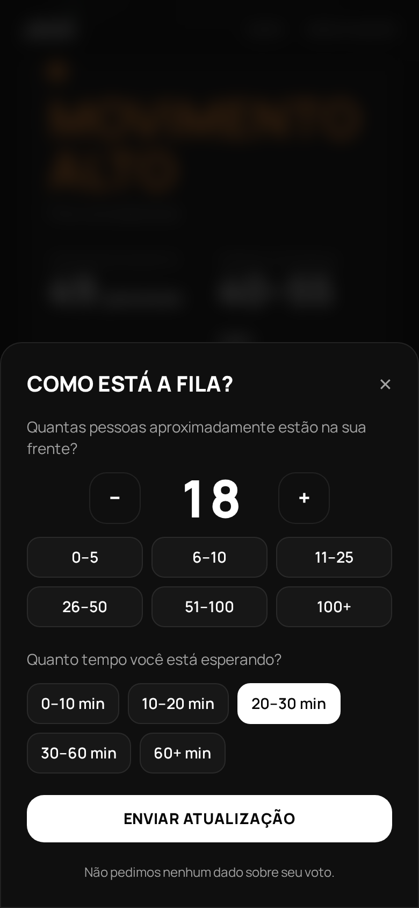 |  |

## 🧱 Tecnologia (visão geral)

| Camada | Tecnologias |
|---|---|
| **Front-end** | React 19, TypeScript, Vite, TanStack Router/Start (SSR), Tailwind CSS, Framer Motion, mapa em SVG próprio |
| **Back-end** | .NET 9 (ASP.NET Core Web API), controllers + camada de regras de negócio, rate limiting nativo, Swagger |
| **Banco de dados** | MongoDB: locais com seções embutidas, coordenadas em GeoJSON com índice geoespacial, busca textual e relatos em coleção própria |
| **Dados** | Importador próprio dos dados abertos do TSE (todas as UFs ou por estado) |

### Arquitetura

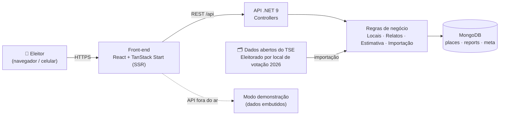

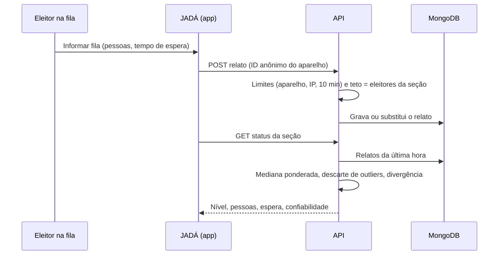

## 🗂️ Dados

- **Base oficial:** *Eleitorado por local de votação 2026*, Portal de Dados Abertos do Tribunal Superior Eleitoral (TSE):
  <https://dadosabertos.tse.jus.br/dataset/eleitorado-2026>
  (arquivo: `eleitorado_local_votacao_2026.zip`). São cerca de **95,7 mil locais de votação**, **517 mil seções** e **158,7 milhões de eleitores**.
- **Licença dos dados:** Creative Commons Atribuição (CC BY). **Fonte: Tribunal Superior Eleitoral (TSE).** O JADÁ apenas reorganiza esses dados para facilitar a busca. Não é afiliado à Justiça Eleitoral nem endossado por ela.
- **Dados da comunidade:** relatos anônimos de fila, sem login e sem nenhuma informação sobre o voto. O aparelho é identificado só por um ID aleatório guardado no próprio navegador.
- **Imagens deste repositório:** usam dados **fictícios** criados para a demonstração.

Achou um local com endereço, nome ou seção errada? Abra uma issue de [**Correção de dados de local de votação**](../../issues/new?template=correcao_de_dados.yml).

## 🚦 Status do projeto

**MVP funcional, em fase de testes.** Busca nacional, página do local, relatos com estimativa robusta, mapa por níveis, Minha seção e importação completa do TSE já funcionam localmente. Os próximos passos (publicação, alertas, PWA, acessibilidade) estão no [ROADMAP.md](ROADMAP.md).

## 🤝 Como contribuir

O código é privado, mas **dá para ajudar muito sem ele**:

- 🐞 [Reportar um bug](../../issues/new?template=bug_report.yml)
- 💡 [Sugerir uma funcionalidade](../../issues/new?template=feature_request.yml)
- 📍 [Corrigir dados de um local de votação](../../issues/new?template=correcao_de_dados.yml)
- 🎨 Dar feedback de UX, design e acessibilidade
- 🌎 Ajudar com traduções e textos
- 📝 Melhorar esta documentação (pull requests são bem-vindos aqui)

Quer colaborar com **código**? Abra uma issue com o título "Pedido de acesso ao código" contando sua experiência e no que quer ajudar. Detalhes em [CONTRIBUTING.md](CONTRIBUTING.md).

Ao participar, você concorda com o [Código de Conduta](CODE_OF_CONDUCT.md). Para falhas de segurança, **não** abra issue pública: siga o [SECURITY.md](SECURITY.md).

## 📬 Contato

Paulo Henz: [@paulohenz](https://github.com/paulohenz) no GitHub. Para assuntos públicos, use as [issues](../../issues).

## 📄 Licença

O conteúdo **deste repositório** (textos, imagens e vídeo) está sob [CC BY 4.0](LICENSE).
O **código-fonte do JADÁ não está incluído** e continua proprietário (todos os direitos reservados).
Os dados do TSE seguem a licença da fonte original (CC BY).

---

### 🇬🇧 English (short)

**JADÁ ("Já dá pra ir?", or "Is it a good time to go?")** shows, in real time, how long the line is at your Brazilian polling place, based on crowd-sourced reports combined with official open data from the Superior Electoral Court (TSE). This is the public **showcase** repository (screenshots, demo video, roadmap and issue tracker). The application source code is private. Bug reports, feature ideas, polling-place data corrections and UX feedback are welcome through issues. Screenshots use fictional demo data. Docs and media: CC BY 4.0.
